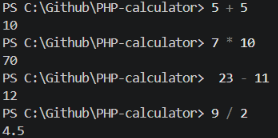

# PHP-calculator
Backend development - Opdracht functies maken

Een simpele rekenmachine voor de terminal, geschreven in PHP met functies en een loop.

## Functies

- `getNumber()`: vraagt om een getal
- `getOperation()`: vraagt om een operator (+, -, *, /)
- `calculate()`: voert de berekening uit
- `askAgain()`: vraagt of je opnieuw wilt rekenen

## Gebruik

Wat je doet is je kiest een getal, dan een operator en dan weer een getal.
Zie afbeelding voor voorbeeld

